# App walkthrough, 27 Oct 2026

A walkthrough of Mac Mouse Fix NG, from a clean config, driven with computer use. Build: `beta` plus the changes from this session, Debug, `FORCE_LICENSED`, version 3.1.0 (25324).

## How it ran

1. Built settings export and import first (see below).
2. Copied `config.plist` and the app's user defaults to a scratch folder, as a safety net.
3. Exported the settings with the new feature to `~/Documents/mmf-walkthrough-export.json`. All five exported sections (AppTabs, General, Pointer, Remaps, Scroll) matched the raw `config.plist`.
4. Moved `config.plist` away and deleted the app's user defaults, then launched the new build.
5. Went through General, Buttons (with an app tab and the Chrome preset), Scrolling, About and the app menu.
6. Filed issues and fixed them on `beta`.
7. Imported the export file. All exported sections came back exactly as in the raw backup. `State` (launch counters, last tab) and `License` (cached license config) are not exported on purpose, so they differ.

## Settings export and import

- **Where:** File → Export Settings… (⇧⌘E) and Import Settings… (⇧⌘I), and two buttons at the bottom of the General tab.
- **File:** JSON with a small wrapper:

  ```json
  {
    "format": "mac-mouse-fix-settings",
    "formatVersion": 1,
    "appVersion": "3.1.0",
    "appBuild": "25324",
    "configVersion": 24,
    "exportedAt": "2026-10-27T00:36:58Z",
    "settings": { "AppTabs": [...], "General": {...}, "Pointer": {...}, "Remaps": [...], "Scroll": {...} }
  }
  ```

  `settings` holds every top-level config section except `State`, `License`, `Constants` and `AppOverrides`, so sections added later are exported without code changes. Plist data and dates, which JSON lacks, are written as `{"$data": "<base64>"}` and `{"$date": "<ISO 8601>"}`.
- **Import and versions:**
  - Import starts from the app's default config.
  - Each value from the file replaces the default only if its type matches. A string can't land where the app reads a number.
  - Keys the defaults don't have (AppTabs, or keys from a newer version) are kept.
  - `State`, `License` and `Constants` stay as they are on this Mac.
  - A file from a newer `configVersion` gets a warning in the confirmation alert. A file with a newer `formatVersion` is refused with a message to update the app.
  - `ConfigTransfer.migrated(_:from:)` is where future steps go if a config version changes the shape of an exported section.
  - Importing remaps also sets `State.remapsAreInitialized`. Without that, the first enable after a reset would replace the imported rows with the default rows.
- **Code:** `App/Utility/ConfigTransfer.swift`.

## Findings

| # | Finding | Kind | Status |
|---|---|---|---|
| [#6](https://github.com/soyoxymor0n/mac-mouse-fix-ng/issues/6) | The update toggles in the General tab, and "Check for Updates…", could check the upstream feed. Sparkle could then offer the official app as an update to NG. | Bug | Fixed: update section and menu item hidden, stale `SUFeedURL` removed at launch |
| [#7](https://github.com/soyoxymor0n/mac-mouse-fix-ng/issues/7) | "Activate License…" and "Buy Mac Mouse Fix…" still show in `FORCE_LICENSED` builds | UX | Fixed: hidden in those builds |
| [#8](https://github.com/soyoxymor0n/mac-mouse-fix-ng/issues/8) | Preset review sheet overflows its margins. Its action names differ from the ones the table shows afterwards | UX | Fixed |
| [#9](https://github.com/soyoxymor0n/mac-mouse-fix-ng/issues/9) | Preset banner text is cut off ("button 5 for…") | UX | Fixed: two lines, small font |
| [#10](https://github.com/soyoxymor0n/mac-mouse-fix-ng/issues/10) | Library action names are cut off in the button table, with no way to read them | UX | Fixed: tooltip shows the full name |
| [#11](https://github.com/soyoxymor0n/mac-mouse-fix-ng/issues/11) | App tab strip sticks to the bottom of the Buttons tab | UX | Fixed: tabs start at the top |
| [#12](https://github.com/soyoxymor0n/mac-mouse-fix-ng/issues/12) | Chrome tab rows were lost once after a relaunch | Bug | Open: not reproduced; same pattern as the upstream "Remaps Deleted" bug log |
| — | First version of the export/import button row made the window 100,000 px tall | Bug (new code) | Fixed before commit |

### Left for you to decide (no issue filed)

- **Long library names.** The review sheet now uses the library's name ("Open the previous page in browsing history for the current tab ⌘←") instead of the preset's short "Back ⌘←", so it matches the table. Short names for library entries would read better in both places, but that's a change to the generated library.
- **About tab links.** "Submit Feedback", "Send Me an Email", "Visit the Website" and "Buy Me a Milkshake" all go to the upstream author. That's fine for attribution, but feedback about NG goes to the wrong place.
- **Gap in the review sheet.** There's still a small gap between the column headers and the first row.

## Screenshots

Before the fixes:

| | |
|---|---|
| First launch, app off 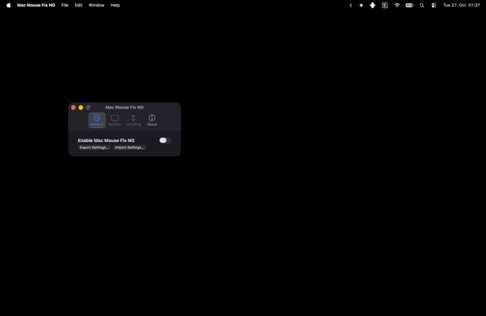 | General with update toggles 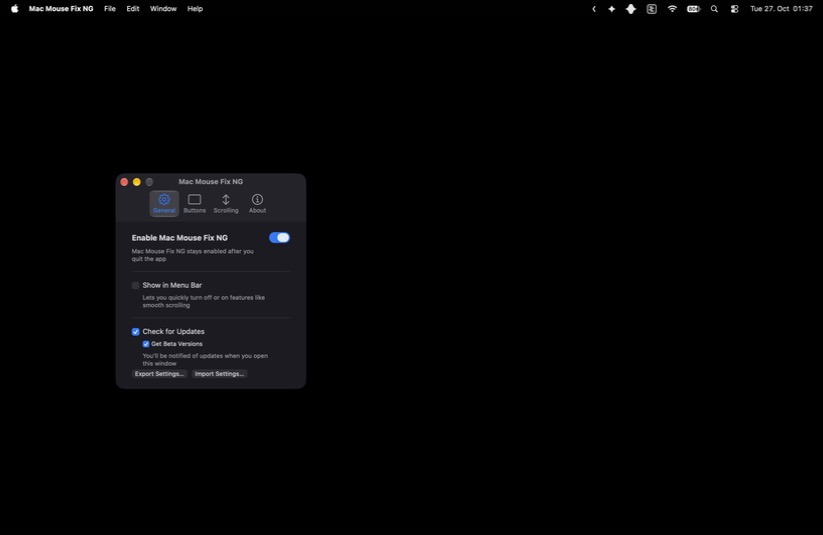 |
| Buttons, strip at the bottom 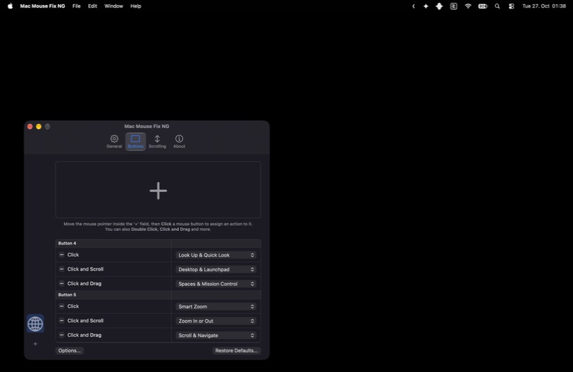 | App picker 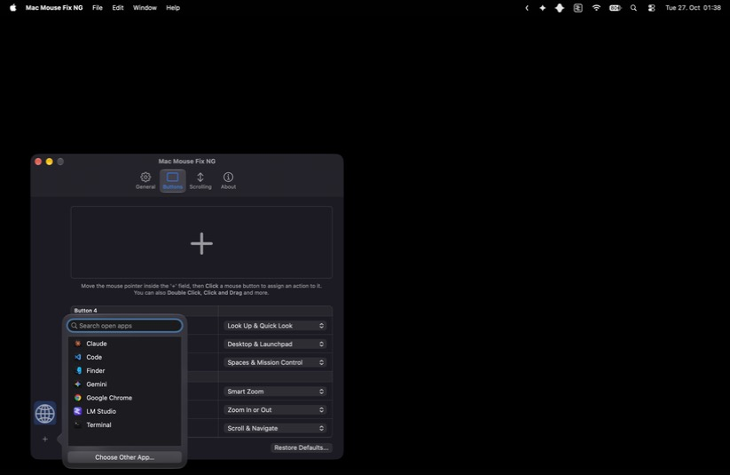 |
| Banner cut off 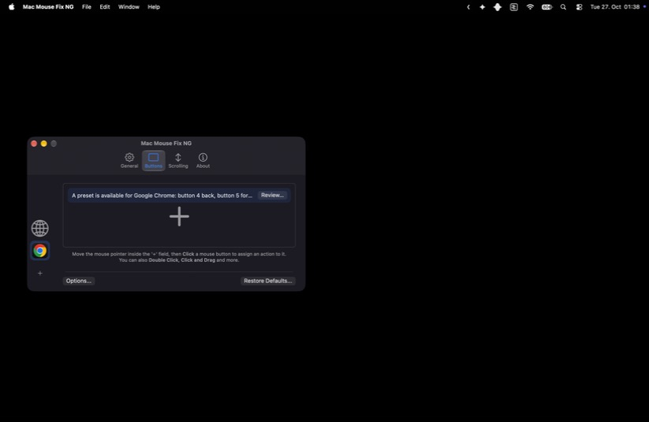 | Review sheet overflowing 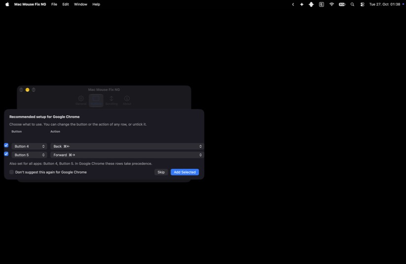 |
| Table names cut off 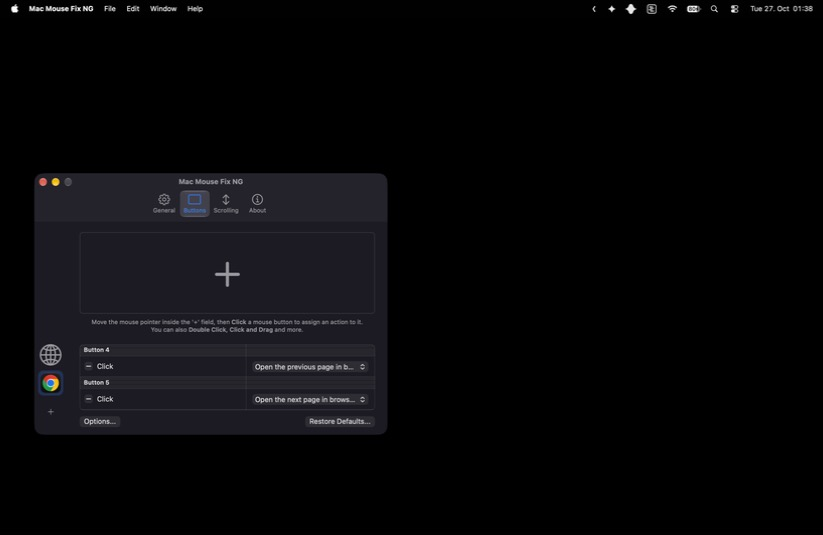 | App menu with license and update items 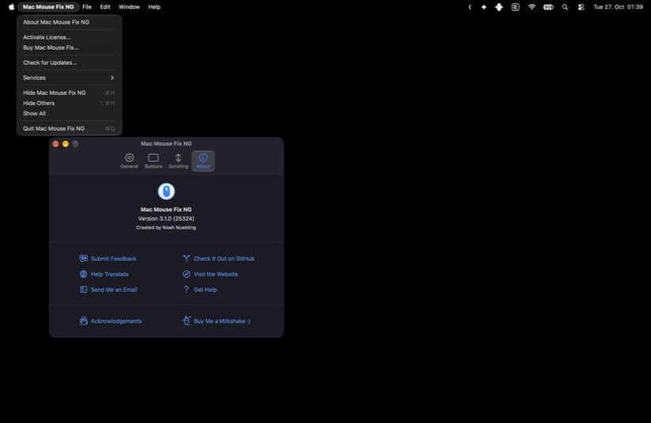 |
| Scrolling 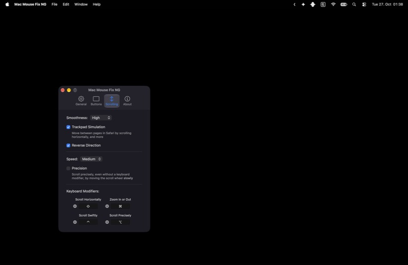 | About, no trial section 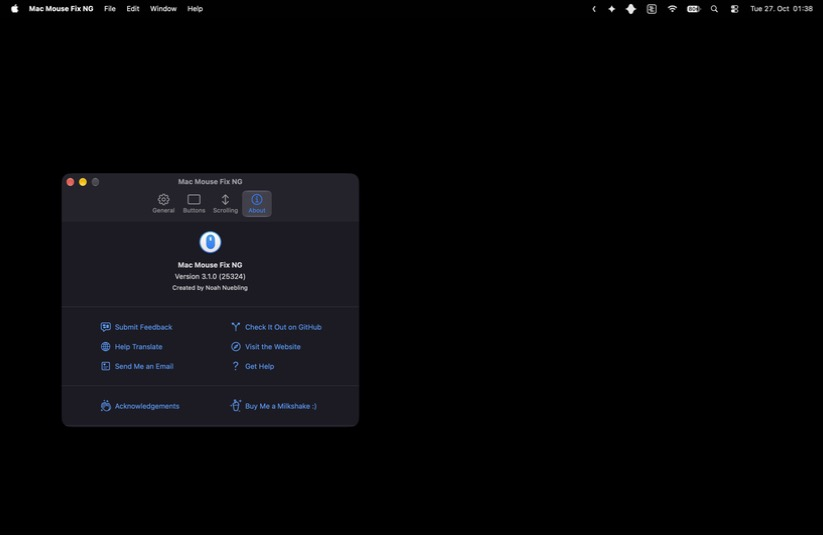 |

After the fixes:

| | |
|---|---|
| App menu 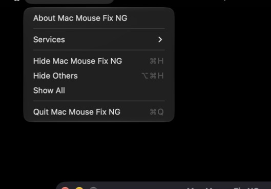 | General 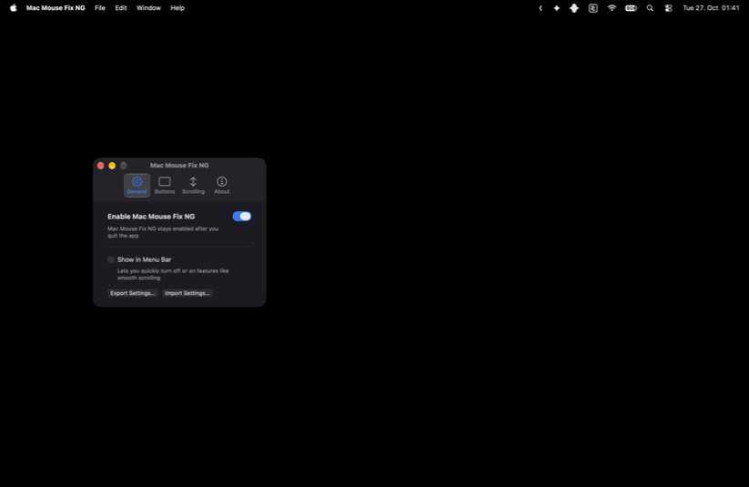 |
| Buttons, strip at the top 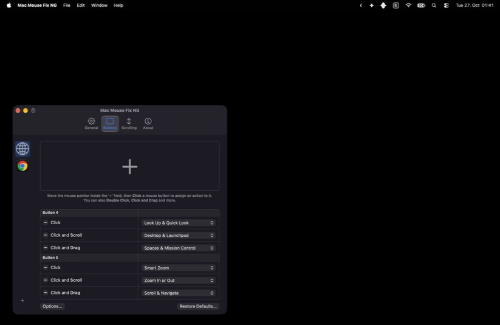 | Banner 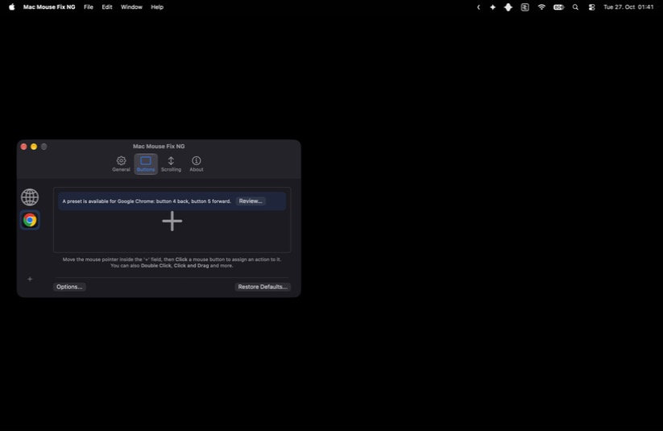 |
| Review sheet 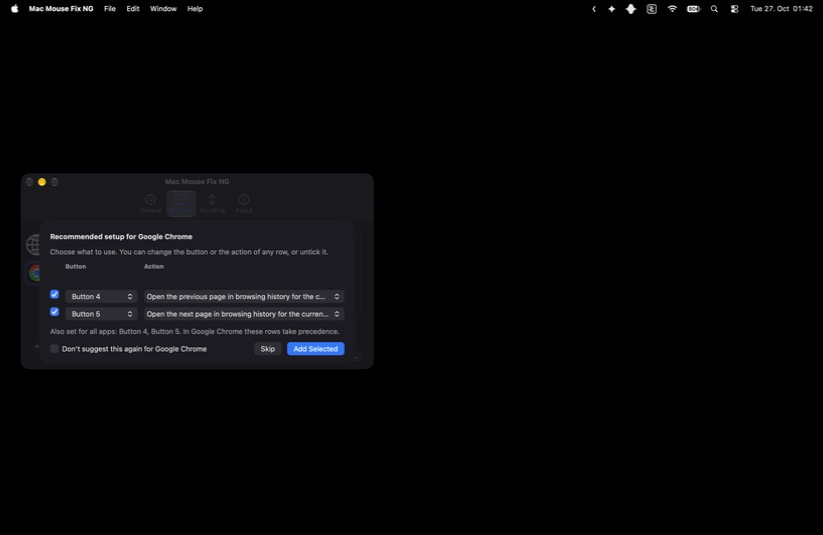 | Import confirmation 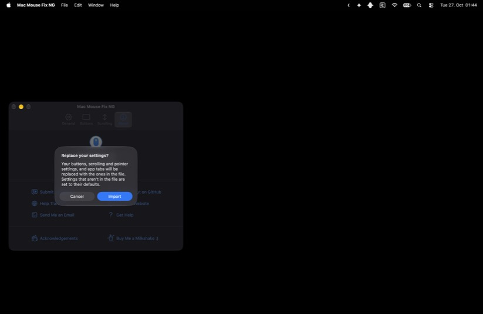 |
| After import (Teams and VS Code tabs back) 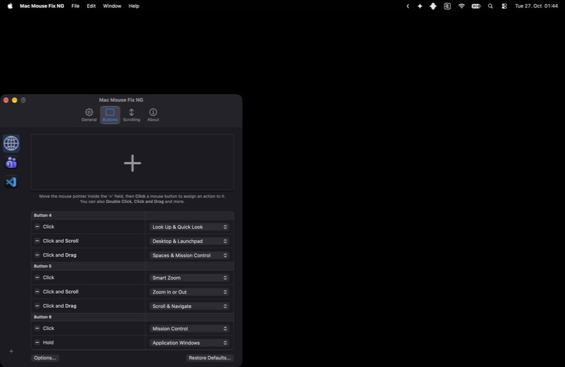 | |

## Not covered

- Pressing real mouse buttons. Computer use can't press mouse buttons 3 to 5, so it can't check that the remaps fire.
- The Accessibility prompt. The helper was already allowed, so the first enable didn't ask.
- The tooltip from #10 was built but not hovered in the walkthrough.
